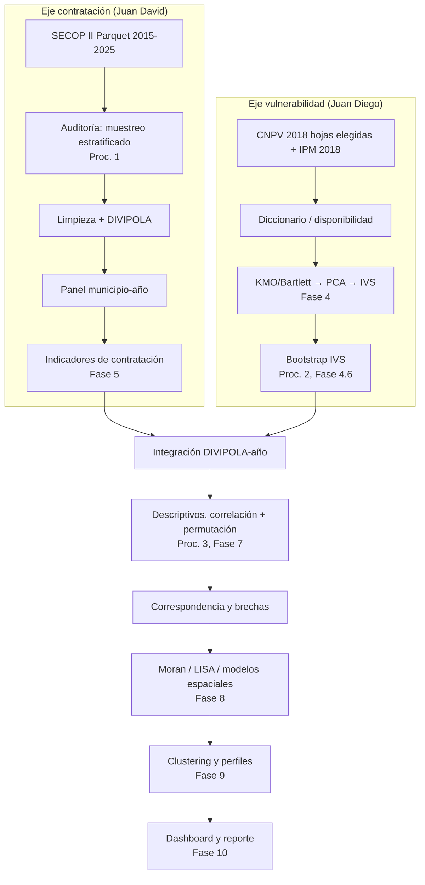

# Resumen_Claude.md — Documento de transferencia

> Generado el 2026-10-01 a partir del *Informe 1 — Versión integrada* (`Informe1_Estado_Arte_Muestreo_Division_Trabajo.tex`) y de notas del autor.
> Convención: `[PENDIENTE: ...]` marca información que no consta en esas fuentes. Los snippets de la sección 6 son **diseño en R, no código verificado del repositorio**.

## 1. Resumen Ejecutivo

Proyecto de grado de Estadística (Universidad Santo Tomás, dos integrantes) que estudia si la distribución territorial de la contratación pública (SECOP II, histórico 2015–2025, ~7,8 M de registros) corresponde a la vulnerabilidad socioeconómica de los municipios colombianos, medida con un índice sintético (IVS) construido por PCA sobre el IPM censal 2018 del DANE y variables compatibles.
El alcance es asociativo/descriptivo (sin causalidad). El procesamiento se hace íntegramente en R/RStudio, asistido por el agente OpenCode.
Estado: diseño metodológico y marco teórico cerrados; selección de hojas DANE hecha; la construcción del diccionario de variables DANE está bloqueada por un desajuste con las hojas; el resto del pipeline está sin evidencia de implementación `[PENDIENTE: confirmar qué scripts existen y corren]`.

## 2. Objetivos

**Objetivo general.** Determinar empíricamente si existe correspondencia entre la intensidad de contratación pública y la vulnerabilidad socioeconómica a nivel municipal en Colombia, y caracterizar las brechas territoriales resultantes.
`[PENDIENTE: redacción formal del objetivo general; el Informe 1 lista su redacción como tarea abierta]`

**Objetivos específicos**

- Auditar la calidad de SECOP II mediante muestreo estratificado y fijar la ventana temporal analítica definitiva.
- Construir un IVS municipal (PCA sobre IPM + indicadores compatibles) y validar su estabilidad por *bootstrap*.
- Construir indicadores de contratación por municipio–año (valor, número, per cápita, modalidad, sector, tipo, duración).
- Medir asociación (Spearman/Pearson, regresión, permutación) y definir una medida de correspondencia y de brecha.
- Diagnosticar dependencia espacial (Moran, LISA) y, si procede, ajustar modelos espaciales (SAR/SEM/SDM).
- Clasificar municipios (clustering) y producir un dashboard/mapas.

**No-objetivos / out-of-scope**

- Inferencia causal.
- Evaluar eficiencia, corrupción o calidad de la política pública a partir de una brecha.
- Imputar artificialmente la evolución anual del IPM cuando no existe frecuencia anual.
- Encuesta de percepción de equidad (muestreo por conglomerados): solo documentada como línea futura.
- Modelos espaciales *a priori*: solo si los diagnósticos de dependencia lo justifican.

## 3. Estado Actual

**✅ Funcional / cerrado**

- Diseño metodológico (3 procedimientos de muestreo/remuestreo), hipótesis H1–H6, operacionalización y división de trabajo (Informe 1).
- Decisión de hojas CNPV 2018 para el IVS (ver sección 8).
- Disponibilidad de insumos DANE en `datos/`.

**🚧 En progreso**

- Diccionario de variables DANE/IPM y matriz de disponibilidad municipal.
- Evaluación de variables adicionales compatibles (TerriData/DNP u otras).
- `[PENDIENTE: estado del eje SECOP II (auditoría del histórico, muestreo, limpieza)]`

**⛔ Bloqueado / roto**

- El diccionario de variables generado por script no coincide con las hojas de los cuadros DANE (plantillas con encabezados en varias filas). Pendiente decidir/ajustar la lectura por hoja.

| Módulo | Estado | Notas |
|---|---|---|
| Diseño metodológico / marco teórico | ✅ | Informe 1, versión integrada |
| Selección de hojas CNPV 2018 | ✅ | 6 hojas de contenido + 2 de contexto |
| Diccionario de variables DANE | ⛔ | Desajuste script vs. plantillas multi-encabezado |
| IPM 2018 (`IPM_2018_organizado_region.xlsx`) | 🚧 | 1.122 municipios, 15 indicadores de privación; constructo 1 del IVS |
| Variables complementarias (TerriData) | 🚧 | Compatibilidad de periodo/calidad sin decidir |
| Auditoría SECOP II (muestreo estratificado) | `[PENDIENTE]` | Responsable: Juan David Parada Fonseca |
| Limpieza + panel municipio–año | `[PENDIENTE]` | Depende de la auditoría |
| Integración DIVIPOLA | `[PENDIENTE]` | DIVIPOLA csv (2026-09-17) disponible en `datos/` |
| KMO/Bartlett + PCA + IVS | `[PENDIENTE]` | Fase 4, responsable Juan Diego Gallo Quintero |
| Bootstrap del IVS | `[PENDIENTE]` | Fase 4.6 |
| Indicadores de contratación (Fase 5) | `[PENDIENTE]` | |
| Asociación, permutación, correspondencia (Fase 7) | `[PENDIENTE]` | |
| Espacial, clustering, dashboard (Fases 8–10) | `[PENDIENTE]` | |

## 4. Arquitectura

Árbol de directorios (solo lo confirmado; el resto es `[PENDIENTE]`):

```text
<raíz-del-repo>/
├── Resumen_Claude.md          # este documento
├── datos/                     # insumos DANE (confirmado)
│   ├── CNPV 2018: cuadros HOGARES, PERSONAS_DEMOGRAFICO, PERSONAS_SOCIAL, VIVIENDAS
│   ├── anexo-censal-pobreza-municipal-2018
│   ├── IPM_2018_organizado_region.xlsx
│   └── DIVIPOLA (csv, 2026-09-17)
├── [PENDIENTE: scripts/ R/ — scripts de diccionario, limpieza, PCA]
├── [PENDIENTE: salidas/ — diccionarios, paneles, figuras]
└── [PENDIENTE: SECOP II — archivos Parquet trimestrales; ubicación y si viven en el repo]
```

Referencia externa: repositorio `desarrollo_social_y_economico` (USTA), punto de partida para fuentes y estructura; incluye el notebook `Historico_de_Datos.ipynb` (histórico SECOP II trimestral en Parquet). No es código propio ni límite metodológico.

Flujo de datos y fases:



Numeración de fases usada en el Informe 1: 2 revisión de datos, 3 limpieza, 4 índice (4.6 validación), 5 indicadores de contratación, 6 descriptivos, 7 asociación (7.1 correlación, 7.4 correspondencia), 8 espacial, 9 clustering, 10 dashboard/reporte. `[PENDIENTE: contenido de la Fase 1; el diagrama de flujo original no está en las fuentes]`

## 5. Decisiones Técnicas (ADRs condensados)

### ADR-1 — Muestreo aleatorio estratificado para auditar SECOP II

- **Contexto** → Auditar manualmente 7,8 M de registros es inviable; la calidad es heterogénea entre años (cambios normativos, migraciones de plataforma, crecimiento no lineal del volumen).
- **Decisión** → MAS dentro de estratos (año/trimestre × cuartil de valor), tamaño con corrección por población finita, asignación proporcional por defecto, Neyman como alternativa; estimador estratificado con IC por dimensión de calidad (5 dimensiones binarias).
- **Alternativas** → MAS (peor varianza con heterogeneidad), sistemático (riesgo de periodicidad con el orden del archivo), conglomerados por entidad (efecto de diseño >1).
- **Consecuencias** → Ventaja: estimaciones válidas por año, que priorizan reglas de limpieza. Costos: la auditoría de cada registro muestreado es manual; Neyman exige conocer $S_h$ (requiere piloto); con $\hat p_h=0$ la varianza de Wald colapsa a 0, por lo que conviene un IC alternativo (Wilson/Clopper–Pearson) en estratos con pocas inconsistencias; `p=0.5` sobredimensiona la muestra si el error real es bajo.

### ADR-2 — Bootstrap para validar estabilidad del PCA/IVS

- **Contexto** → Cargas factoriales y varianza explicada son estimaciones puntuales; ~1.100 municipios, indicadores asimétricos, eigenvalues posiblemente cercanos.
- **Decisión** → $B\ge1000$ remuestras de municipios (y *bootstrap* por bloques de departamentos cuando haya agrupamiento relevante); reajustar PCA en cada réplica; IC percentil o BC$_a$; verificar H6 (signo y orden de magnitud estables).
- **Alternativas** → fórmulas asintóticas (supuesto de normalidad dudoso), *jackknife* (errático con vectores propios), validación cruzada (mide predicción, no incertidumbre de parámetros).
- **Consecuencias** → Los componentes tienen indeterminación de signo/rotación: sin alinear cada réplica con la solución de referencia, los IC son artefactos (ver snippet 4). El *bootstrap* por bloques de departamentos tiene pocos conglomerados (~32), lo que limita la calidad de sus IC. Si los eigenvalues están muy próximos, los componentes pueden intercambiarse entre réplicas.

### ADR-3 — Prueba de permutación para la asociación IVS–contratación

- **Contexto** → La contratación es asimétrica a la derecha, con masa en valores bajos/nulos y muchos empates; los $p$ asintóticos de Spearman/Kendall pierden precisión con empates.
- **Decisión** → $P\ge5000$ permutaciones de la asignación municipio–valor de contratación, con el mismo estadístico de correspondencia de la Fase 7.4; reportar el $p$ empírico junto al paramétrico.
- **Alternativas** → Pearson/OLS (normalidad), Spearman/Kendall asintótico, chi-cuadrado (discretiza y pierde potencia).
- **Consecuencias** → Libre de supuestos distribucionales, pero asume intercambiabilidad bajo H0. Si hay autocorrelación espacial (hipótesis H4), los municipios no son intercambiables y el $p$ puede ser demasiado optimista; observación del redactor: contrastar con el diagnóstico de Moran antes de interpretar, o evaluar permutaciones restringidas por departamento/región `[PENDIENTE: decidir con el equipo]`.

### ADR-4 — IVS vía PCA con el IPM como núcleo conceptual

- **Contexto** → La vulnerabilidad no debe reducirse al ingreso; el IPM municipal censal 2018 cubre todos los municipios.
- **Decisión** → IPM como referente; variables adicionales solo con respaldo conceptual, calidad y comparabilidad; PCA con KMO/Bartlett, criterio de Kaiser/sedimentación y verificación de signos (invertir variables cuyo aumento signifique menor vulnerabilidad).
- **Alternativas** → Índice por promedio ponderado/normativo `[PENDIENTE: alternativas evaluadas en el informe]`.
- **Consecuencias** → La fuente censal es de un solo corte (2018), así que no hay frecuencia anual y el panel municipio–año no puede tener IVS que varíe en el tiempo sin supuestos adicionales; no se imputará su evolución. La varianza explicada máxima no es el único criterio de retención.

### ADR-5 — Unidad municipio; ventana 2015–2025 solo exploratoria

- **Contexto** → La cobertura y comparabilidad de SECOP II y DANE a lo largo del periodo no están verificadas.
- **Decisión** → Municipio como unidad (departamento solo para contexto y visualización); el periodo analítico definitivo se fija después de la auditoría.
- **Alternativas** → Fijar 2015–2025 de entrada; analizar solo departamentos.
- **Consecuencias** → Se evita forzar comparabilidad, a costa de retrasar la Fase 5 hasta cerrar la Fase 2. La localización de la entidad contratante no implica que el beneficio quede en ese municipio (limitación de interpretación).

### ADR-6 — División de trabajo por pipeline y todo en R

- **Contexto** → Dos fuentes independientes hasta la integración territorial.
- **Decisión** → Juan Diego: eje DANE/IPM (Fases 2-DANE, 4); Juan David: eje SECOP II (Fases 2-SECOP, 3, 5); fases 6–10 por tarea; validación cruzada de entregables antes de avanzar. Procesamiento en R/RStudio.
- **Alternativas** → División por fase completa.
- **Consecuencias** → Menos duplicación, pero la integración DIVIPOLA–año y los cambios de periodo o de definición de correspondencia requieren acuerdo explícito de ambos.

## 6. Fragmentos Clave de Código

> Todo lo siguiente es **diseño derivado del Informe 1**, no código extraído del repositorio. Rutas reales: `[PENDIENTE: ruta de cada script al implementarse]`.

### 6.1 Configuración de hojas CNPV 2018 elegidas

- **Ruta:** `[PENDIENTE: p. ej. R/config_hojas.R]`
- **Por qué importa:** las plantillas DANE tienen encabezados en varias filas y el diccionario automático ya falló contra ellas. Fijar explícitamente qué hoja alimenta el IVS evita que el script recorra hojas irrelevantes y es la base de la lectura por hoja.

```r
hojas_ivs <- list(
  HOGARES              = c("1HM", "2HM"),
  PERSONAS_DEMOGRAFICO = c("17PM"),
  PERSONAS_SOCIAL      = c("5PM"),
  VIVIENDAS            = c("6V_MPIO", "8V_MPIO", "10V_MPIO")
)

# Hojas de contexto: denominadores, no entran como indicadores del PCA
hojas_contexto <- list(
  PERSONAS_DEMOGRAFICO = "1PM",
  VIVIENDAS            = "1V_MPIO"
)
```

### 6.2 Tamaño de muestra con corrección por población finita

- **Ruta:** `[PENDIENTE: p. ej. R/muestreo_auditoria.R]`
- **Por qué importa:** con $N\approx7{,}8\times10^6$ la corrección apenas mueve $n$, pero fijar $p=0.5$, $e$ y $\alpha$ en un solo lugar hace la ficha técnica reproducible. Los valores de $e$ y confianza son `[PENDIENTE: no definidos en el informe]`.

```r
n_muestra <- function(N, p = 0.5, e = 0.02, conf = 0.95) {
  z  <- qnorm(1 - (1 - conf) / 2)
  n0 <- z^2 * p * (1 - p) / e^2
  ceiling(n0 / (1 + (n0 - 1) / N))
}
```

### 6.3 Estratificación, asignación proporcional y extracción reproducible

- **Ruta:** `[PENDIENTE: R/muestreo_auditoria.R]`
- **Por qué importa:** la semilla y los $N_h$ del marco determinan la auditoría completa; redondear $n_h$ cambia el $n$ total, y un estrato con $n_h<2$ hace indefinida la varianza ($n_h-1$ en el denominador).

```r
library(dplyr)
set.seed(20260901)  # [PENDIENTE: semilla definitiva; documentarla en la ficha técnica]

marco <- marco |>
  mutate(estrato = interaction(anio, cuartil_valor, drop = TRUE))
  # [PENDIENTE: cuartiles de valor globales o dentro de cada año]

asig <- marco |>
  count(estrato, name = "N_h") |>
  mutate(n_h = pmin(N_h, pmax(2, round(n * N_h / sum(N_h)))))  # n_h >= 2 para estimar varianza

muestra <- marco |>
  inner_join(asig, by = "estrato") |>
  group_by(estrato) |>
  slice_sample(n = first(n_h)) |>
  ungroup()
```

### 6.4 Estimador estratificado de proporción con IC

- **Ruta:** `[PENDIENTE: R/muestreo_auditoria.R]`
- **Por qué importa:** es el cálculo que convierte la auditoría manual en una tasa de error poblacional por dimensión de calidad. Con $\hat p_h=0$ o $1$ el IC de Wald degenera; es el primer lugar donde conviene sustituirlo por Wilson si hay estratos limpios.

```r
est_estratificado <- function(df, conf = 0.95) {
  # df: una fila por estrato con N_h, n_h, p_h (proporción muestral de la dimensión)
  N    <- sum(df$N_h)
  W    <- df$N_h / N
  p_st <- sum(W * df$p_h)
  v_st <- sum(W^2 * df$p_h * (1 - df$p_h) / (df$n_h - 1) * (1 - df$n_h / df$N_h))
  z    <- qnorm(1 - (1 - conf) / 2)
  c(p = p_st, lwr = p_st - z * sqrt(v_st), upr = p_st + z * sqrt(v_st))
}
```

### 6.5 Bootstrap del PCA con alineación de signo

- **Ruta:** `[PENDIENTE: p. ej. R/ivs_bootstrap.R]`
- **Por qué importa:** los vectores propios están definidos salvo signo; sin alinear cada réplica con la solución de referencia, los IC de las cargas cruzan cero por artefacto y H6 se rechazaría falsamente. Se re-estandariza dentro de cada réplica (`scale.=TRUE`); si el equipo prefiere estandarizar una vez, hay que decidirlo explícitamente `[PENDIENTE]`. El remuestreo por departamentos corresponde al *bootstrap* por bloques del Procedimiento 2.

```r
boot_pca <- function(X, depto = NULL, B = 1000, k = 1, seed = 1) {
  # X: indicadores (municipios x variables) ya invertidos en sentido de vulnerabilidad
  set.seed(seed)
  ref <- prcomp(X, center = TRUE, scale. = TRUE)
  v0  <- ref$rotation[, 1:k, drop = FALSE]
  cargas <- array(NA_real_, c(B, ncol(X), k), dimnames = list(NULL, colnames(X), NULL))
  varexp <- matrix(NA_real_, B, k)

  for (b in seq_len(B)) {
    idx <- if (is.null(depto)) {
      sample.int(nrow(X), replace = TRUE)
    } else {  # bootstrap por bloques: departamentos completos
      d <- sample(unique(depto), replace = TRUE)
      unlist(lapply(d, function(x) which(depto == x)))
    }
    fit <- prcomp(X[idx, , drop = FALSE], center = TRUE, scale. = TRUE)
    v   <- fit$rotation[, 1:k, drop = FALSE]
    for (j in seq_len(k)) if (sum(v[, j] * v0[, j]) < 0) v[, j] <- -v[, j]  # alinear signo
    cargas[b, , ] <- v
    varexp[b, ]   <- (fit$sdev^2 / sum(fit$sdev^2))[1:k]
  }
  list(
    ic_cargas = apply(cargas[, , 1], 2, quantile, probs = c(0.025, 0.975)),
    ic_varexp = apply(varexp, 2, quantile, probs = c(0.025, 0.975))
  )
}
```

### 6.6 Prueba de permutación para la correspondencia

- **Ruta:** `[PENDIENTE: p. ej. R/correspondencia_permutacion.R]`
- **Por qué importa:** es la inferencia que sostiene H1 sin supuestos de normalidad. Se usa $(1+\#)/(P+1)$ en lugar de la proporción simple del informe para no reportar $p=0$ exacto (desviación menor, a confirmar con el equipo). El estadístico es Spearman como placeholder; el índice definitivo sale de la Fase 7.4 `[PENDIENTE]`.

```r
perm_test <- function(ivs, y, P = 5000, seed = 1) {
  ok <- complete.cases(ivs, y); ivs <- ivs[ok]; y <- y[ok]
  set.seed(seed)
  obs  <- cor(ivs, y, method = "spearman")
  nula <- replicate(P, cor(ivs, sample(y), method = "spearman"))
  list(obs = obs, nula = nula,
       p = (1 + sum(abs(nula) >= abs(obs))) / (P + 1))
}
```

## 7. Stack y Dependencias

**Lenguajes**

- R (RStudio): `[PENDIENTE: versión de R]`.
- Python: solo en el repositorio de referencia (notebook `Historico_de_Datos.ipynb`); `[PENDIENTE: confirmar si el proyecto propio lo usa]`.

**Librerías clave** (versiones `[PENDIENTE: fijar con renv::snapshot()]`)

| Uso | Paquete candidato | Versión |
|---|---|---|
| Lectura de hojas Excel DANE | `readxl` | `[PENDIENTE]` |
| Parquet | `arrow` | `[PENDIENTE]` |
| Manipulación | `dplyr`, `tidyr` | `[PENDIENTE]` |
| PCA / KMO / Bartlett | `stats::prcomp`, `psych` | `[PENDIENTE]` |
| Espacial | `sf`, `spdep`, `spatialreg` | `[PENDIENTE]` |
| Panel | `plm` | `[PENDIENTE]` |

Los paquetes de la tabla son candidatos coherentes con las técnicas del informe, no dependencias confirmadas.

**Variables de entorno:** `[PENDIENTE: ninguna documentada; confirmar rutas a datos SECOP II y semilla global]`

**Comandos**

```bash
# install   [PENDIENTE: p. ej. Rscript -e 'renv::restore()' si se usa renv]
# run       [PENDIENTE: scripts de entrada, p. ej. Rscript R/00_run_all.R]
# test      [PENDIENTE: p. ej. Rscript -e 'testthat::test_dir("tests")']
```

## 8. Datos y Pipelines

**Fuentes**

| Fuente | Contenido | Hechos confirmados |
|---|---|---|
| SECOP II (Datos Abiertos Colombia / Colombia Compra Eficiente) | Contratos electrónicos | Histórico trimestral desde 2T-2015 a 4T-2025 (4T-2025 parcial, hasta 2025-10-05); 7.827.129 registros, 59 variables; Parquet |
| DANE CNPV 2018 | Cuadros municipales: HOGARES, PERSONAS_DEMOGRAFICO, PERSONAS_SOCIAL, VIVIENDAS | Archivos en `datos/` |
| DANE IPM 2018 | `IPM_2018_organizado_region.xlsx` y `anexo-censal-pobreza-municipal-2018` | 1.122 municipios, 15 indicadores de privación |
| DIVIPOLA | Códigos territoriales | csv de 2026-09-17 en `datos/` |
| TerriData (DNP) | Variables complementarias | `[PENDIENTE: no seleccionadas]` |
| Población municipal | Denominador per cápita | `[PENDIENTE: fuente y año]` |

**Esquemas**

- SECOP II: las 59 variables `[PENDIENTE: diccionario completo]`; campos usados según el informe: entidad, ubicación (DIVIPOLA), fechas de inicio/terminación, sector, valor, modalidad, tipo de contrato.
- Hojas CNPV: elegidas en 6.1; encabezados en varias filas (causa del desajuste con el diccionario automático).

**Transformaciones previstas**

1. Lectura por hoja con manejo de encabezados multi-fila → diccionario (variable, definición, escala, fuente).
2. Selección y estandarización de indicadores; inversión de variables con sentido opuesto; KMO/Bartlett → PCA → IVS.
3. SECOP II: estandarización DIVIPOLA → limpieza según auditoría → agregación a municipio–año → indicadores (valor total, nº contratos, per cápita, mediana, ticket promedio, participaciones por modalidad/sector/tipo, duración).
4. Integración IVS × contratación por DIVIPOLA–año (tarea conjunta).

**Validaciones**

- Auditoría muestral SECOP II con cinco dimensiones binarias: duplicidad; inconsistencia territorial (DIVIPOLA inexistente/contradictorio); campos clave incompletos; valor atípico no justificado; incoherencia temporal (duración negativa/implausible).
- Verificación de cobertura municipal completa e identificación de municipios no certificados o con datos faltantes.
- Observación de consistencia: el informe cita ~1.100 municipios y el IPM trae 1.122; confirmar el universo definitivo `[PENDIENTE]`.

## 9. Testing

- **Framework:** `[PENDIENTE: no hay pruebas documentadas]`.
- **Cobertura:** `[PENDIENTE]`.
- **Ejecución:** `[PENDIENTE]`.
- **Casos críticos propuestos** (a implementar, no existentes):
  - Lectura de hojas DANE: número de municipios esperado y ausencia de duplicados de código.
  - Cruce DIVIPOLA: proporción de contratos sin municipio homologable.
  - `n_muestra()` y `est_estratificado()`: casos con solución analítica conocida (p. ej. un solo estrato equivale a MAS).
  - `boot_pca()`: con datos simulados de carga conocida, el signo se mantiene tras alinear.
  - `perm_test()`: con $y$ independiente, el $p$ se distribuye aproximadamente uniforme.
  - Reproducibilidad: misma semilla produce la misma muestra y los mismos IC.

## 10. Deuda Técnica y TODOs

| Item | Prioridad | Impacto | Estimación |
|---|---|---|---|
| Arreglar lectura de hojas DANE con encabezados multi-fila y regenerar el diccionario | Alta | Bloquea Fase 2-DANE y la selección de indicadores del IVS | `[PENDIENTE]` |
| Fijar entorno reproducible (versión de R, `renv`) | Alta | Reproducibilidad de PCA/bootstrap | `[PENDIENTE]` |
| Definir universo municipal (1.122 vs ~1.100) y regla para no certificados | Alta | Afecta el $N$ del PCA y la integración | `[PENDIENTE]` |
| Decidir fuente y año de población municipal | Alta | Bloquea valor per cápita | `[PENDIENTE]` |
| Decidir variables TerriData compatibles | Media | Define el alcance del IVS más allá del IPM | `[PENDIENTE]` |
| Definir estadístico de correspondencia (Fase 7.4) | Media | Condiciona la permutación y las brechas | `[PENDIENTE]` |
| Resolver intercambiabilidad bajo dependencia espacial en la permutación | Media | Validez del $p$ empírico (ADR-3) | `[PENDIENTE]` |
| IC alternativos para estratos con $\hat p_h\in\{0,1\}$ | Media | Validez del IC de la auditoría | `[PENDIENTE]` |
| Pruebas automatizadas | Media | Sin red de seguridad para refactors | `[PENDIENTE]` |
| Ampliar revisión bibliográfica (Scopus, WoS, SciELO, Redalyc) | Media | Confirmar el vacío de investigación (hoy provisional) | `[PENDIENTE]` |
| Documentar cambios de esquema SECOP II entre años | Media | Comparabilidad temporal | `[PENDIENTE]` |

## 11. Próximos Pasos

**Corto plazo (esta semana)** `[PENDIENTE: confirmar prioridades con el equipo]`

- Resolver el desajuste del diccionario DANE leyendo únicamente las hojas de 6.1.
- Completar el diccionario de variables IPM y la matriz de disponibilidad municipal.
- Verificar cobertura municipal y listar municipios con datos faltantes o no certificados.
- Fijar entorno R reproducible y estructura de directorios del repositorio.

**Medio plazo (este mes)**

- Decidir variables complementarias (TerriData) y construir la matriz de indicadores del IVS.
- Ejecutar KMO/Bartlett, PCA, verificación de signos y primer IVS; correr el *bootstrap* (6.5).
- Eje SECOP II (Juan David): ejecutar auditoría muestral, fijar la ventana temporal definitiva, limpieza y panel municipio–año.
- Integrar paneles por DIVIPOLA–año (tarea conjunta) y avanzar a descriptivos (Fase 6).

## 12. Referencias

**Repositorio y datos**

- Repositorio de referencia: `desarrollo_social_y_economico` (Universidad Santo Tomás) `[PENDIENTE: URL]`.
- Repositorio propio / issues / PRs: `[PENDIENTE]`.
- SECOP II — Contratos Electrónicos (Datos Abiertos Colombia); Colombia Compra Eficiente (2026), SECOP II.
- DANE (2018), *Medida de pobreza multidimensional de fuente censal*.
- DNP (2024), *TerriData*.

**Literatura**

- Arachia, G. et al. (2024). Intermunicipal cooperation in public procurement. *Regional Studies, 58*(11). https://doi.org/10.1080/00343404.2024.2350615
- Ardila-Rueda, L. (2004). Gasto público y convergencia regional en Colombia. *Ensayos Sobre Política Económica, 22*(45).
- Bonet-Morón, J. (2006). *Desequilibrios regionales en la política de descentralización en Colombia* (DTSERU No. 77). Banco de la República.
- Cochran, W. G. (1977). *Sampling techniques* (3.ª ed.). Wiley.
- Díaz Díez, C. A. (2023). Obligatoriedad del SECOP para entidades con régimen contractual excepcional. *Revista Eurolatinoamericana de Derecho Administrativo, 10*(2).
- Efron, B., & Tibshirani, R. J. (1993). *An introduction to the bootstrap*. Chapman & Hall/CRC.
- Ferry, L., et al. (2023). Public procurement as a policy tool: The territorial dimension. *Regional Studies, 57*(11). https://doi.org/10.1080/00343404.2022.2134850
- Figueroa-Gómez, Y., & Galpin, I. (2024). Identifying public tenders of interest using classification models. *SN Computer Science, 5*, 87. https://doi.org/10.1007/s42979-023-02443-3
- Good, P. I. (2005). *Permutation, parametric, and bootstrap tests of hypotheses* (3.ª ed.). Springer.
- Gutiérrez Vanegas, K. F. (2024). *Implementación de banderas rojas en la contratación pública en Colombia utilizando datos abiertos* [Trabajo de grado]. Fundación Universitaria Los Libertadores.
- Lohr, S. L. (2019). *Sampling: Design and analysis* (3.ª ed.). CRC Press.
- Monsalvo Herrera, A. E., & Jiménez, W. G. (2025). Pobreza multidimensional: un análisis espacial en los municipios de Cundinamarca. *Novum Jus, 19*(2). https://doi.org/10.14718/NovumJus.2025.19.2.8
- Rodriguez-Plesa, E., Dimand, A.-M., & Alkadry, M. G. (2022). *Journal of Cleaner Production, 338*, 130556. https://doi.org/10.1016/j.jclepro.2022.130556
- Salazar, A., Pérez, J. F., & Gallego, J. (2024). VigIA. *Data & Policy, 6*, e75. https://doi.org/10.1017/dap.2024.83
- Sarter, E. K. (2024). Public procurement and labour market inequality. *Journal of Industrial Relations, 66*(1). https://doi.org/10.1177/00221856231221417
- Särndal, C.-E., Swensson, B., & Wretman, J. (1992). *Model assisted survey sampling*. Springer-Verlag.
