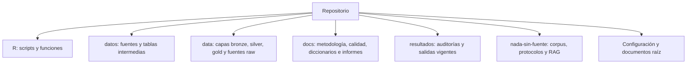

# Mapa del repositorio

Inventario de **299 archivos** versionados o visibles para Git (rastreados y no ignorados), actualizado el 18 de octubre de 2026. Excluye `.git`, respaldos locales bajo `tmp/`, borradores y artefactos locales ignorados, corridas exploratorias ignoradas y este propio archivo de mapa.

## Diagrama general



## Árbol completo por ruta

```text
.
├── .github/
│   └── workflows/
│       └── docs.yml
├── .obsidian/
│   ├── app.json
│   ├── appearance.json
│   ├── core-plugins.json
│   ├── graph.json
│   └── workspace.json
├── data/
│   ├── bronze/
│   │   └── .gitkeep
│   ├── gold/
│   │   └── .gitkeep
│   ├── raw/
│   │   ├── dane_ipm/
│   │   │   └── .gitkeep
│   │   ├── divipola/
│   │   │   └── .gitkeep
│   │   ├── secop_ii/
│   │   │   └── .gitkeep
│   │   └── .gitkeep
│   ├── silver/
│   │   └── .gitkeep
│   └── README.md
├── datos/
│   ├── intermedio/
│   │   ├── contexto_1PM.csv
│   │   ├── contexto_1V.csv
│   │   ├── control_nacional.csv
│   │   ├── hogares_1HM_2HM.csv
│   │   ├── ipm_municipal_ancho.csv
│   │   ├── persona_demo_17PM.csv
│   │   ├── persona_social_5PM.csv
│   │   ├── viviendas_10V.csv
│   │   ├── viviendas_6V.csv
│   │   └── viviendas_8V.csv
│   ├── trabajo/
│   │   ├── demografico_1PM_completo_largo.csv
│   │   ├── denominadores_edad_quinquenal.csv
│   │   ├── denominadores_municipales.csv
│   │   ├── indicadores_municipales_base_total.csv
│   │   ├── indicadores_municipales_base_valida.csv
│   │   ├── ipm_municipal_ancho.csv
│   │   ├── matriz_pca.csv
│   │   ├── matriz_pca_base_valida.csv
│   │   └── matriz_pca_z.csv
│   ├── .gitkeep
│   ├── anexo-censal-pobreza-municipal-2018.xlsx
│   ├── CUADROS_MUNICIPALES_UNIDOS.xlsx
│   ├── DIVIPOLA-_Códigos_municipios_20260917.csv
│   ├── HOGARES_Cuadros_CNPV_2018.XLSX
│   ├── Indices de bases y filas.xlsx
│   ├── IPM_2018_organizado_region.xlsx
│   └── VIVIENDAS_Cuadros_CNPV_2018.XLSX
├── docs/
│   ├── calidad/
│   │   ├── auditorias/
│   │   │   ├── ACTUALIZACION_DESCRIPTIVA_20261018.md
│   │   │   ├── AUDITORIA_CONSISTENCIA_HALLAZGOS.md
│   │   │   ├── AUDITORIA_CONSISTENCIA_PLAN.md
│   │   │   ├── CONTROL_ENTREGA_DESCRIPTIVA_20261018.md
│   │   │   ├── cotejo_cifras_auditoria.csv
│   │   │   ├── DIAGNOSTICO_ESTADO_ACTUAL.md
│   │   │   ├── INFORME_METODOLOGICO_REVISION_FINAL.pdf
│   │   │   ├── INFORME_METODOLOGICO_REVISION_FINAL.tex
│   │   │   ├── JUSTIFICACION_BIBLIOGRAFICA_AUDITORIA.md
│   │   │   ├── PROPUESTAS_DECISION_AUDITORIA.md
│   │   │   ├── REFERENCIAS_NO_INCLUIDAS.md
│   │   │   ├── referencias_nuevas.bib
│   │   │   ├── RESUMEN_EJECUTIVO_AUDITORIA.md
│   │   │   ├── VERIFICACION_CONSOLIDADOS.md
│   │   │   └── verificar_cifras_auditoria.R
│   │   ├── limpieza/
│   │   │   ├── limpieza_candidatos.csv
│   │   │   └── REPORTE_LIMPIEZA.md
│   │   ├── .gitkeep
│   │   ├── auditoria_datos.md
│   │   ├── Auditoria_Estadistica_Indicadores.md
│   │   ├── auditoria_log.txt
│   │   ├── auditoria_v2_log.txt
│   │   ├── cobertura_municipal.csv
│   │   ├── DIAGNOSTICO_ESTADO_ACTUAL.md
│   │   ├── estado_diccionarios_iteracion.md
│   │   ├── fuentes_datos.md
│   │   └── REPORTE_LIMPIEZA.md
│   ├── diccionario/
│   │   ├── .gitkeep
│   │   ├── decisiones_variables_IVS_CNPV2018.csv
│   │   ├── Desicion_Diccionario.md
│   │   ├── inventario_bases.csv
│   │   ├── ipm_dimensiones_indicadores.csv
│   │   └── README.md
│   ├── handoff_GPT/
│   │   └── Resumen_GPT.md
│   ├── informe1_metodologico/
│   │   ├── anexos/
│   │   │   ├── anexo_a.tex
│   │   │   └── anexo_b.tex
│   │   ├── secciones/
│   │   │   ├── actualizacion/
│   │   │   │   ├── descriptivos_sensibilidades_20261018.tex
│   │   │   │   ├── diccionario_operativo_variables.tex
│   │   │   │   ├── diccionarios_decisiones.tex
│   │   │   │   ├── diseno_y_fundamento.tex
│   │   │   │   ├── formulas_pruebas_auditoria.tex
│   │   │   │   ├── fuentes_y_extraccion.tex
│   │   │   │   ├── indicadores_formulas.tex
│   │   │   │   ├── limitaciones_pendientes.tex
│   │   │   │   ├── pca_estado.tex
│   │   │   │   ├── tratamientos_sensibilidad.tex
│   │   │   │   ├── universo_territorial.tex
│   │   │   │   └── verificacion_resultados.tex
│   │   │   ├── actualizacion_metodologica.tex
│   │   │   ├── conclusiones.tex
│   │   │   ├── control_calidad.tex
│   │   │   ├── diagnostico.tex
│   │   │   ├── estado_proyecto.tex
│   │   │   ├── fuentes.tex
│   │   │   ├── indicadores.tex
│   │   │   ├── introduccion.tex
│   │   │   ├── limitaciones.tex
│   │   │   ├── marco_conceptual.tex
│   │   │   ├── metodologia.tex
│   │   │   ├── palabras_clave.tex
│   │   │   ├── portada.tex
│   │   │   ├── preparacion_pca.tex
│   │   │   ├── reproducibilidad.tex
│   │   │   ├── resumen.tex
│   │   │   ├── seleccion_bases.tex
│   │   │   ├── tratamiento_faltantes.tex
│   │   │   └── unidad_analisis.tex
│   │   ├── CHANGELOG_FORMATO.md
│   │   ├── Informe1_Metodologico.pdf
│   │   ├── main.tex
│   │   ├── README_Informe1.md
│   │   └── referencias.bib
│   ├── metodologia/
│   │   ├── anm_divipola_2018_verificadas_20261018.csv
│   │   ├── Formulas_indicadores_IVS_candidatos_2026-10-15.md
│   │   └── seleccion_variables_ivs.md
│   ├── Estado_del_arte_Marco_teorico_proyecto_grado_Juan_Diego_Gallo.docx
│   ├── index.md
│   ├── Informe1_Estado_Arte_Muestreo_Division_Trabajo.pdf
│   ├── Informe1_Estado_Arte_Muestreo_Division_Trabajo.tex
│   ├── Resumen_Claude.md
│   └── Resumen_GPT.md
├── nada-sin-fuente/
│   ├── corpus/
│   │   ├── MANIFIESTO.md
│   │   └── README_PROCEDENCIA.md
│   ├── evaluacion/
│   │   ├── acta_auditoria_cruzada.md
│   │   ├── banco_preguntas.md
│   │   └── caso_de_fallo.md
│   ├── experimento/
│   │   ├── clasificacion_independiente/
│   │   │   ├── clasificacion_juan_david.md
│   │   │   └── clasificacion_juan_diego_David_Sanchez.md
│   │   └── experimento_y_decision.md
│   ├── inventario_fallos/
│   │   ├── inventario_juan_david.md
│   │   └── inventario_juan_diego_David_Sanchez.md
│   ├── memoria/
│   │   └── memoria_final.md
│   ├── protocolo_prompts/
│   │   ├── CHANGELOG.md
│   │   ├── v1.md
│   │   └── v2.md
│   ├── sistema/
│   │   ├── resultados/
│   │   │   ├── evaluacion_qwen2.5-coder_2026-10-13_1302.json
│   │   │   ├── evaluacion_qwen2.5-coder_2026-10-13_1302.md
│   │   │   ├── evaluacion_qwen3.5-4b_2026-10-13_1704.json
│   │   │   └── evaluacion_qwen3.5-4b_2026-10-13_1704.md
│   │   ├── tests/
│   │   │   └── test_rag.py
│   │   ├── banco.json
│   │   ├── fuentes.json
│   │   ├── rag.py
│   │   ├── README.md
│   │   └── requirements.txt
│   ├── .gitignore
│   ├── README.md
│   └── tabla_trazabilidad.md
├── outputs/
│   ├── figuras/
│   │   └── .gitkeep
│   └── tablas/
│       └── .gitkeep
├── R/
│   ├── auxiliares/
│   │   ├── cotejar_extremos_descriptivos.py
│   │   └── verificar_entrega_descriptiva.py
│   ├── funciones/
│   │   ├── auditoria_archivos.R
│   │   ├── auditoria_archivos_v2.R
│   │   ├── auditoria_estadistica.R
│   │   ├── auditoria_ipm.R
│   │   ├── auditoria_territorial.R
│   │   ├── generar_informe_calidad.R
│   │   ├── io.R
│   │   ├── solucion_pendientes.R
│   │   ├── utils.R
│   │   └── validacion.R
│   ├── tests/
│   │   └── test_pipeline_indicadores.R
│   ├── .gitkeep
│   ├── 00_config.R
│   ├── 00_ingesta_fuentes.R
│   ├── 01_auditoria_bases.R
│   ├── 01_auditoria_bases_v2.R
│   ├── 01_verificar_consolidados.R
│   ├── 02_base_final_indicadores.R
│   ├── 03_auditoria_indicadores.R
│   ├── 04_analizar_pendientes.R
│   ├── 04_auditoria_estrato_paredes.R
│   ├── 05_conformar_indicadores_finales.R
│   ├── 06_descriptivos_sensibilidades_ivs.R
│   ├── auditoria_simple.R
│   ├── auditoria_simple_fixed.R
│   ├── final_auditoria.R
│   ├── final_auditoria_corrected.R
│   ├── final_auditoria_fixed.R
│   ├── final_auditoria_fixed2.R
│   ├── final_auditoria_working.R
│   ├── separate_dictionaries.R
│   └── separate_dictionaries_final.R
├── resultados/
│   ├── auditoria_estadistica/
│   │   ├── baseline_antes/
│   │   │   ├── Final_Base.md
│   │   │   └── manifest.csv
│   │   ├── 01_matriz_decision_indicadores.csv
│   │   ├── 02_hallazgos_conceptuales.csv
│   │   ├── 03_hallazgos_distribucion.csv
│   │   ├── 04_hallazgos_outliers.csv
│   │   ├── 05_hallazgos_correlacion.csv
│   │   ├── 06_hallazgos_kmo.csv
│   │   ├── 07_hallazgos_no_respuesta.csv
│   │   ├── 08_recomendacion_variables_pca.csv
│   │   └── 09_resumen_auditoria.csv
│   ├── base_trabajo/
│   │   ├── areas_inexistentes.csv
│   │   ├── auditoria_conteos.csv
│   │   ├── ausencias_estructurales_1PM.csv
│   │   ├── correlaciones_pares.csv
│   │   ├── covariables_descriptivas.csv
│   │   ├── crosswalk_enlace.csv
│   │   ├── diagnosticos_aptitud.csv
│   │   ├── especificacion_indicadores.csv
│   │   ├── estadisticos_indicadores.csv
│   │   ├── kmo_por_indicador.csv
│   │   ├── md5_insumos_antes.csv
│   │   ├── md5_insumos_despues.csv
│   │   ├── municipios_sin_cabecera.csv
│   │   ├── nombres_columnas_fuente.csv
│   │   ├── nr_item_municipal.csv
│   │   ├── outliers_z_mayor_4.csv
│   │   ├── parametros_estandarizacion.csv
│   │   ├── pares_correlacion_ge_090.csv
│   │   ├── pares_correlacion_ge_095.csv
│   │   ├── resumen_hallazgos.csv
│   │   ├── resumen_sin_cabecera_departamento.csv
│   │   ├── sensibilidad_nr.csv
│   │   ├── sensibilidad_nr_municipio.csv
│   │   ├── validaciones.csv
│   │   └── varianza_indicadores.csv
│   ├── descriptivos_sensibilidades_20261018/
│   │   ├── figuras/
│   │   │   ├── distribuciones_cuatro.pdf
│   │   │   └── sensibilidad_denominadores.pdf
│   │   ├── tablas_tex/
│   │   │   ├── correlaciones_sensibilidad.tex
│   │   │   ├── descriptivos_cuatro.tex
│   │   │   ├── razones_sumas.tex
│   │   │   └── sensibilidades.tex
│   │   ├── candidatas_sensibilidad_reservadas.csv
│   │   ├── clasificacion_territorial_2018.csv
│   │   ├── correlaciones_escenarios.csv
│   │   ├── cotas_no_respuesta_servicios.csv
│   │   ├── cotejo_extremos_excel.csv
│   │   ├── descriptivos_cuatro_informe.csv
│   │   ├── descriptivos_ocho_por_ambito.csv
│   │   ├── descriptivos_sensibilidades_reservadas.csv
│   │   ├── extremos_z_mayor_4_para_cotejo.csv
│   │   ├── indicadores_anm.csv
│   │   ├── indicadores_ocho_todas_unidades.csv
│   │   ├── integridad_excel_cotejo.csv
│   │   ├── integridad_insumos.csv
│   │   ├── isla_san_andres.csv
│   │   ├── matriz_ocho_municipal_e_insular_0_1.csv
│   │   ├── numeradores_denominadores.csv
│   │   ├── resumen_ejecucion.csv
│   │   ├── sensibilidad_correlaciones.csv
│   │   ├── sensibilidad_correlaciones_territorial.csv
│   │   ├── sensibilidades_formulas_por_ambito.csv
│   │   ├── sensibilidades_por_codigo.csv
│   │   ├── sessionInfo.txt
│   │   ├── solapamiento_conceptual_ipm.csv
│   │   ├── verificacion_formulas.csv
│   │   └── verificacion_tablas_pdf.csv
│   ├── indicadores_finales_ivs_20261015/
│   │   ├── candidatas_17PM_descriptivas.csv
│   │   ├── chequeos_matriz.csv
│   │   ├── cobertura_indicadores_pca.csv
│   │   ├── formulas_indicadores.csv
│   │   ├── indicadores_municipales_y_denominadores.csv
│   │   ├── matriz_pca_candidata.csv
│   │   ├── matriz_pca_candidata_z.csv
│   │   ├── parametros_z_pca.csv
│   │   ├── resumen_ejecucion.csv
│   │   ├── resumen_sensibilidad.csv
│   │   └── sensibilidad_no_respuesta_municipal.csv
│   ├── solucion_pendientes/
│   │   └── estructura_10V_6V_20261015_v05/
│   │       ├── control_suma_materiales_6V.csv
│   │       ├── estado_ejecucion.csv
│   │       ├── integridad_insumos.csv
│   │       ├── materiales_pared_6V_por_municipio.csv
│   │       ├── materiales_pared_6V_resumen.csv
│   │       ├── sensibilidad_10V_estrato_controles.csv
│   │       ├── sensibilidad_10V_estrato_por_municipio.csv
│   │       ├── sensibilidad_10V_estrato_resumen.csv
│   │       ├── sensibilidad_8V_gas_internet_controles.csv
│   │       ├── sensibilidad_8V_gas_internet_por_municipio.csv
│   │       └── sensibilidad_8V_gas_internet_resumen.csv
│   ├── verificacion_consolidados/
│   │   ├── chequeos_consistencia.csv
│   │   ├── cobertura_municipal_por_hoja.csv
│   │   ├── discrepancias.csv
│   │   ├── inventario_hojas_columnas.csv
│   │   ├── mapa_llaves.csv
│   │   └── universo_municipal_maestro.csv
│   └── .gitkeep
├── src/
│   └── .gitkeep
├── tests/
│   └── .gitkeep
├── .gitignore
├── .gitattributes
├── 2026-10-13.md
├── Correccion_Estructura_Bases.md
├── Estructura_Bases.md
├── Final_Base.md
├── Informe_Metodologico_Obsidian.md
├── Inicio_Proyecto.md
├── mkdocs.yml
├── README.md
├── requirements.txt
├── requirements-analysis.txt
├── Resumen_General.md
├── SECURITY.md
├── Solucion_pendientes.md
└── TRASH_OUT.md
```
